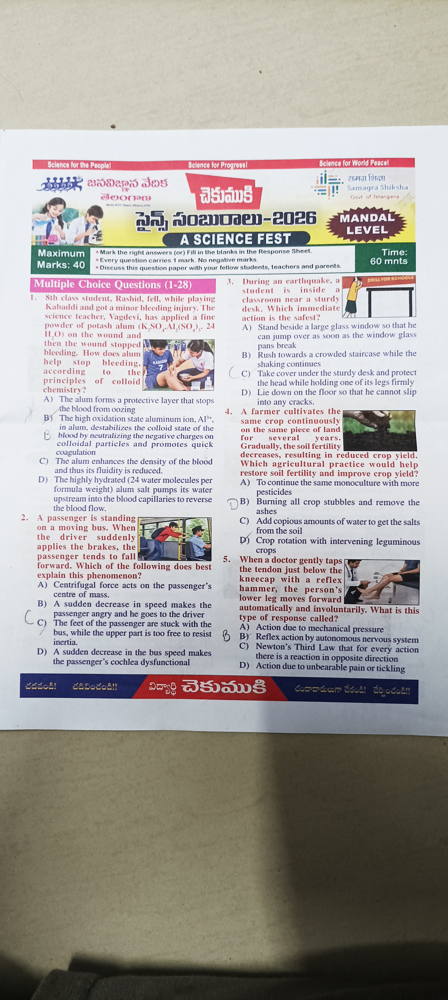
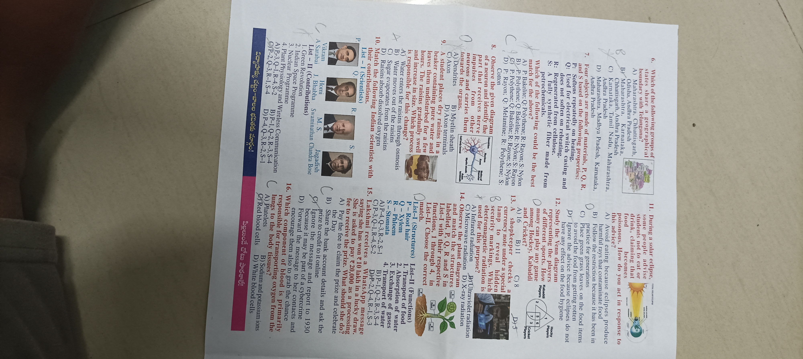
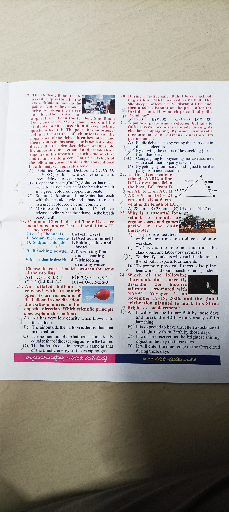
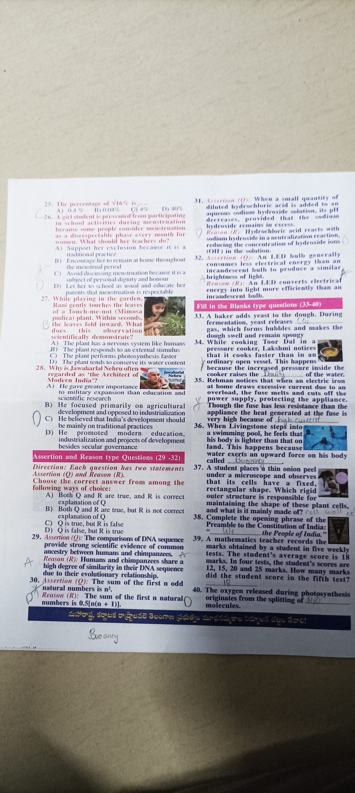

# Your mandal paper — original pages + worked answers 🏆

[Unmodified originals and response sheet](original-mandal-facsimile.md) · [School worked paper](original-school-worked.md) · [Workout index](README.md)

The images below contain the **original photographed questions, options, figures and handwriting**. Under each page group, question descriptions are **short paraphrases**, not a verbatim transcription; zoom the original for the exact question and choices. Our checks are **unofficial**, not an organiser's key. ⚠ marks wording, interpretation or image uncertainty. Your confirmed mandal score is **34/40**; these checks do not identify which answers you submitted or recalculate your official score.

## Questions 1–5: original page 1

1. **Alum and a minor bleeding wound, colloid-chemistry explanation:** **B appears intended**, describing charge neutralisation and coagulation of colloidal particles. Actual haemostasis and alum's astringent effects are more complex than the printed explanation. This is not first-aid advice; don't apply chemicals to wounds.
2. **Passenger falls forward as bus brakes:** **C, intended idea.** The lower body slows with the bus while the upper body tends to retain its motion. The phrase “feet are stuck” is an oversimplification.
3. **Earthquake safety near a sturdy desk:** **C.** Take cover, protect your head and hold on; follow local guidance.
4. **Restoring soil fertility after repeated cropping:** **D.** Crop rotation with legumes can support soil fertility, subject to local conditions.
5. **Knee-jerk when tendon is tapped:** **⚠ B is the closest intended reflex option but is imprecise.** The knee-jerk is a spinal **somatic** reflex; calling it autonomic is incorrect. Ask for the official key.

## Questions 6–16: original page 2

6. **States neighbouring Telangana:** **B, Maharashtra, Karnataka, Chhattisgarh and Andhra Pradesh.**
7. **Materials: softening plastic, electrical casing, regenerated cellulose, synthetic fibre:** **C, polythene, Bakelite, rayon, nylon.**
8. **Neuron structure receiving signals and carrying them toward organs:** **⚠ wording combines functions.** Dendrites typically receive signals; the axon conducts impulses away from the cell body toward targets. A single option cannot cleanly satisfy both clauses as written. Check the diagram and official key.
9. **Dry raisins swell in water:** **A, osmosis.** Net water enters through a selectively permeable membrane.
10. **Match scientists and contributions:** **C:** Sarabhai—space; Bhabha—nuclear programme; Swaminathan—Green Revolution; J. C. Bose—plant physiology and wireless.
11. **Claim that eclipse poisons food:** **D.** The eclipse itself does not poison food. Never look directly at the Sun without appropriate certified protection and expert guidance.
12. **Venn diagram of three sports:** **⚠ D, 5, if the central overlap is read correctly.** Only the region common to all three sets counts; verify the small figure in the photo before treating the number as certain.
13. **Banknote security markings:** **B, ultraviolet radiation**, which can reveal fluorescent features.
14. **Match plant structures and functions:** **D:** root hair—water absorption; xylem—water transport; phloem—food transport; stomata—gas exchange.
15. **Prize message demanding a processing fee:** **C.** Do not pay or share credentials; independently verify and report suspected fraud. In India, financial cyber-fraud can be reported to 1930 or [cybercrime.gov.in](https://cybercrime.gov.in/).
16. **Blood component carrying oxygen:** **C, red blood cells**, mainly using haemoglobin.

## Questions 17–24: original page 3

17. **Conventional colour-changing breath analyser:** **A, intended historical chemical method**—acidified potassium dichromate reacts with alcohol. ⚠ Modern analysers use other technologies; a real test requires trained personnel. Do not handle dichromate or acid.
18. **Match common chemicals and uses:** **B:** sodium bicarbonate—baking; sodium chloride—seasoning/preservation; bleaching powder—disinfection; magnesium hydroxide—antacid.
19. **Balloon moves opposite escaping air:** **C is the intended momentum idea**, in an idealised isolated system initially at rest. The balloon and expelled air gain opposite momentum; exact equality for the whole system needs proper accounting for all expelled air and external forces.
20. **₹1,000 bag, 50% off then 60% off the reduced price:** **A, ₹200.** ₹1,000 × 0.5 × 0.4 = ₹200.
21. **Accountability for unfulfilled election promises:** **A.** Public debate and voting are democratic ways to question a party's performance.
22. **Triangle with DE parallel to BC; AD 9, DB 21, AE 6:** **C, 14 cm.** AD/DB = AE/EC, so 9/21 = 6/EC.
23. **Why include sports and games in school:** **D.** Fitness, teamwork, discipline and sportsmanship are important benefits.
24. **Voyager 1 and one light-day milestone:** **B.** A light-day is a distance light travels in one day; see [NASA's report](https://www.nasa.gov/news-release/nasas-voyager-1-makes-history-reaching-one-light-day-from-earth/).

## Questions 25–40: original page 4

For 29–32 the printed choices are A: both true and reason explains; B: both true but reason does not explain; C: assertion true/reason false; D: assertion false/reason true.

25. **Percentage of √16%:** **⚠ notation needs clarification.** If the square root includes the percentage, √(16%) = √0.16 = 0.4 = **40% (D)**. If it means (√16)% = **4% (C)**, the answer differs. Inspect the radical bar and ask the organiser; do not silently assume.
26. **Exclusion from school during menstruation:** **D.** Menstruation is normal; support the student's inclusion and accurate education.
27. **Touch-me-not leaf folds when touched:** **B.** The plant responds to an external stimulus; this does not establish a human-like nervous system.
28. **Nehru and modern India:** **D** is the option describing modern education, industrialisation, development projects and secular governance.
29. **DNA sequence evidence and shared ancestry:** **A, intended.** DNA similarity is evidence of evolutionary relationship, though the wording of the reason partly repeats the claim.
30. **Sum of first n odd numbers; sum of first n natural numbers:** **B, usual interpretation.** Both formulas are true, but the natural-number sum formula alone is not an explicit explanation of the odd-number sum without further algebra.
31. **Acid added to NaOH; reason about neutralisation:** **A.** The hydroxide concentration drops and pH decreases under the stated conditions.
32. **LED and incandescent bulb at similar brightness:** **A.** The LED generally converts electrical energy to visible light more efficiently.
33. **Yeast makes dough rise:** **carbon dioxide (CO₂).**
34. **Pressure cooker raises water's ___:** **boiling point / boiling temperature.**
35. **Fuse heating in an overloaded circuit:** **⚠ current is a plausible intended blank**, but the sentence is misleading: lower resistance alone does not mean more heat than a higher-resistance appliance. Element material, geometry, temperature and heat loss matter. Do not experiment with mains electricity.
36. **Upward force from water:** **buoyancy / upthrust / buoyant force.**
37. **Rigid plant-cell structure and material:** **cell wall, mainly cellulose.**
38. **Preamble opening:** **“We, the People of India.”**
39. **Five-test average 18; four marks 12, 15, 20 and 25:** **18.** Total = 5 × 18 = 90; known marks total 72; 90 − 72 = 18.
40. **Oxygen released in photosynthesis comes from splitting:** **water (H₂O) molecules.**
