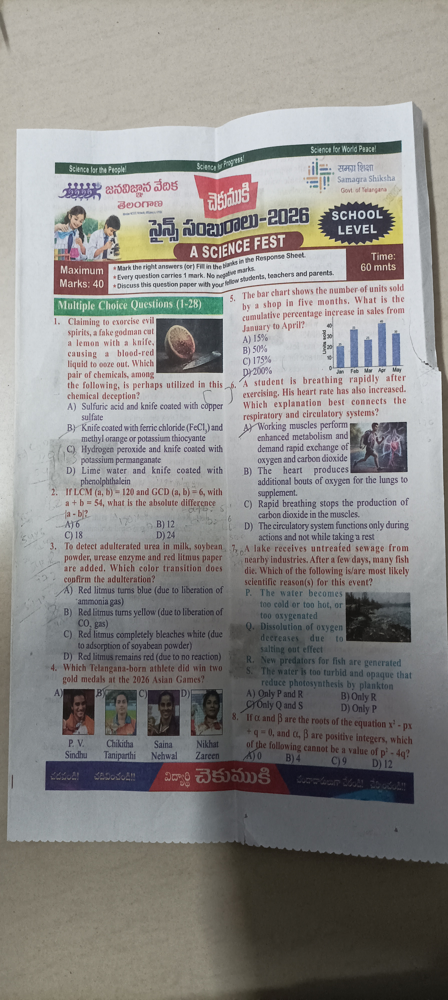
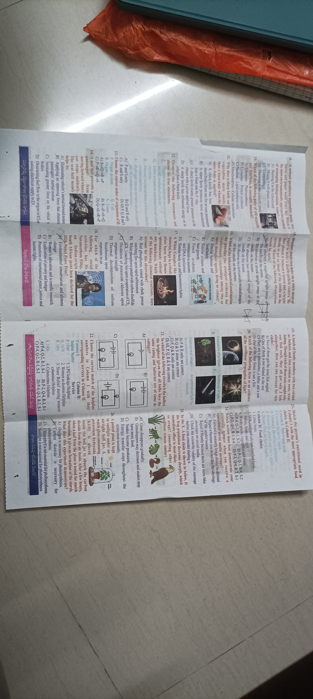
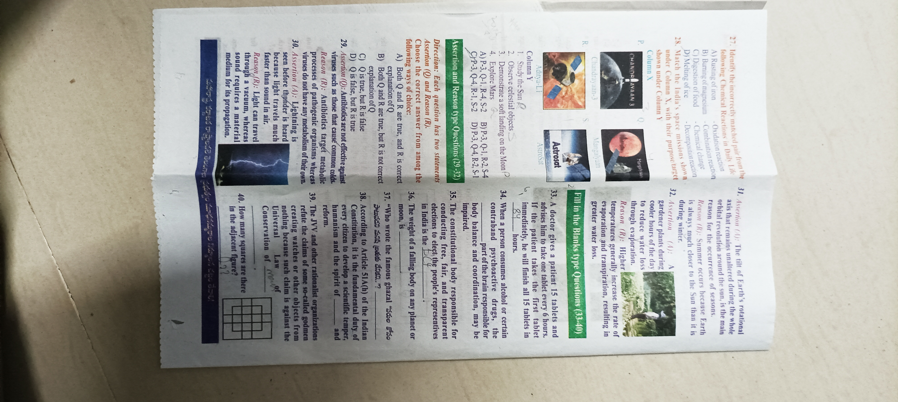

# Your school paper — original pages + worked answers 🔬

[Unmodified originals and response sheet](original-school-facsimile.md) · [Mandal worked paper](original-mandal-worked.md) · [Workout index](README.md)

**How to use:** the images below are the actual supplied photographs, including the original questions, options, diagrams and handwriting. They are not blank or newly typeset. Below each image group are **short paraphrased question identifiers**, not a verbatim transcription, followed by our independent working. Click or zoom each photograph for exact wording and options; two are sideways as originally supplied. We do not have an official key. **⚠ means ambiguous, conditional or not confidently read**; do not use these notes to calculate an official score. Handwritten marks are not an official key or necessarily your final answers.

## Questions 1–8: original first page

1. **Fake blood trick with a lemon and a coated knife:** **B appears intended** (not an official key). The printed option mentions ferric chloride and **methyl orange OR potassium thiocyanate**, but does not fully specify the preparation. Iron(III) plus thiocyanate can form a red complex; separately, methyl orange can turn red in sufficiently acidic lemon juice without ferric chloride. The colour alone does not identify the mechanism. See [paper-specific molecular explanation](../../fresh/13-everyday-science/01-paper-questions.md). Do not perform the demonstration or handle its chemicals.
2. **LCM 120, GCD 6, sum 54; find the difference:** **A, 6.** Product = 120 × 6 = 720; 24 and 30 sum to 54, difference 6.
3. **Urease test for added urea and red litmus:** **A.** Ammonia from urea hydrolysis makes conditions basic, turning red litmus blue. This is not a complete food-safety test; do not try at home.
4. **Telangana-born double-gold archer:** **B, Chikitha Taniparthi**, as reported by [The Hindu](https://www.thehindu.com/sport/other-sports/chikitha-taniparthi-2026-asian-games-gold-compound-archery-la-2028-olympics-profile-bio/article71530197.ece).
5. **Sales graph, percentage increase January to April:** **⚠ no listed option appears correct.** Reading 20 → 40, the increase is (40 − 20)/20 × 100 = **100%**. April is **200% of** January. Check the graph and teacher's intended key.
6. **Breathing and heartbeat during exercise:** **A.** Active muscles generally need more oxygen and produce more carbon dioxide.
7. **Sewage in a lake and fish deaths:** **⚠ C may be intended, not a generally reliable explanation.** Turbidity can reduce photosynthesis and salts can reduce oxygen solubility, but the waste composition is unspecified and decomposition of organic waste can also deplete oxygen. Ask the organiser.
8. **Integer roots and p² − 4q:** **D, 12.** With roots α and β, p² − 4q = (α − β)², an integer square; 12 is not.

## Questions 9–26: original middle spread

9. **Vegetable peels, leaves and paper waste:** **C, composting** appropriate biodegradable material rather than mixing it with plastic or dumping it.
10. **Cell organelle and function match:** **D, mitochondrion—cellular metabolism.** Mitochondria have important roles in cellular energy metabolism.
11. **Why a sharp knife cuts better at the same force:** **C.** A smaller contact area gives greater pressure.
12. **Statements about graphite, iodine, mercury and HCl:** **A, P and S**, as a school-level reading. Graphite conducts; mercury conducts despite being liquid; aqueous HCl conducts via ions. ⚠ Hydrogen ions in solution are hydrated, and the exact wording is simplified.
13. **Order cell, tissue, organ, organ system:** **D, Q → S → R → P.** Cells form tissues, tissues form organs and organs form systems.
14. **Seat belt when a car stops:** **B.** The belt applies a force that slows the passenger; it does not eliminate inertia.
15. **Double-pinhole camera and candle:** **C, two inverted images**, assuming each pinhole projects a distinguishable image on the screen. Depending on spacing the images may overlap.
16. **Strongest evidence for evolutionary relationships:** **C, fossils, comparative anatomy and DNA similarities.** Several independent kinds of evidence are stronger than superficial resemblance alone.
17. **Material appearing to ignite spontaneously in a ritual:** **B appears intended.** White phosphorus can ignite on exposure to air; the printed scenario describes a hazardous chemical deception. **Do not recreate it.**
18. **2026 Nobel Peace Prize citation:** **D, peace, justice and human rights.** See the [Nobel Prize citation](https://www.nobelprize.org/prizes/peace/2026/summary/).
19. **Two fathers and two sons catch three fish:** **C.** Grandfather, father and son: the middle person is both a father and a son.
20. **Evidence for rectilinear propagation of light:** **A, P and R**—eclipse shadows and a pinhole image illustrate straight-line paths in suitable conditions. Scattering and absorption are different phenomena.
21. **Brightest bulb circuit:** **⚠ B under the intended ideal-cell interpretation.** The diagram appears to give one bulb two cells in series; brightness depends on actual supply voltage, cell orientation, bulb rating and resistance. Compare the original figure and teacher's key; the wording “batteries are of same dc voltage” is not perfectly clear.
22. **Match helpline numbers and services:** **⚠ verify current official numbers and the small printed choices.** The 1930 cybercrime helpline is identifiable; the remaining entries and option letters should be checked against an official current directory. No letter asserted here.
23. **Match calcium, vitamin C, protein and fibre to foods:** **C:** milk/curd/calcium-fortified foods; citrus fruits; pulses/beans/eggs; whole grains/vegetables/fruits.
24. **Sensational social-media claim:** **D.** Check scientific validity before sharing.
25. **Frog population falls in a food chain:** **⚠ no fully satisfactory immediate-effect option.** Fewer frogs may allow grasshoppers to increase and snakes to have less food; grass decline is a possible later effect, not necessarily an immediate disappearance. Ask for the official key.
26. **Plant under bell jar with CO₂ removed:** **B.** With appropriate controls and destarching, lack of starch supports the role of carbon dioxide in photosynthesis. Do not handle KOH at home.

## Questions 27–40: original last page

For 29–32 the printed choices are A: both true and reason explains; B: both true but reason does not explain; C: assertion true/reason false; D: assertion false/reason true.

27. **Incorrectly matched change:** **D.** Melting ice is a physical change, not a decomposition reaction.
28. **Match Indian space missions and targets:** **C, P–3, Q–4, R–1, S–2:** Moon landing, Mars, Sun and astronomical observations respectively.
29. **Antibiotics and viruses; reason about metabolism:** **A, intended school-level answer.** Antibiotics target bacterial structures/processes; viruses lack their own independent metabolism. Not every antibiotic targets metabolism specifically, and some target cell structures, so the printed reason is simplified.
30. **Lightning seen before thunder; light and sound media:** **B.** Both statements are true, but the ability to travel in vacuum does not itself explain their different speeds in air.
31. **Earth's tilt and seasons; reason says summer is due to Earth being closer:** **C.** Tilt is the principal cause; the distance explanation is false.
32. **Watering in cooler hours; evaporation/transpiration:** **A.** Warmer conditions generally increase water loss, making cooler periods helpful.
33. **15 tablets, first immediately, one every 6 hours:** **84 hours.** Fourteen intervals × 6. This is arithmetic, not medical advice.
34. **Brain area for balance and coordination:** **cerebellum.**
35. **Constitutional body conducting elections:** **Election Commission of India.**
36. **Weight of a falling body:** **⚠ ambiguous.** Apparent weight may be zero in free fall, but gravitational weight is generally nonzero; the blank just says weight.
37. **Author of the Telugu ghazal:** **⚠ not confidently read/verified.** Please provide a clearer close-up or the official key; no guess.
38. **Scientific temper, humanism and spirit of ___ and reform:** **inquiry.** [Constitution text](https://legislative.gov.in/constitution-of-india/).
39. **Claimed creation from nothing violates conservation of ___:** **mass / mass–energy in the appropriate physical context.** For an everyday object, the substance must come from somewhere; modern physics uses conservation of mass–energy. Check the expected school-level wording.
40. **Count squares in the figure:** **⚠ not reliably counted from this photo.** A clear straight-on close-up and checking each square size are needed.
